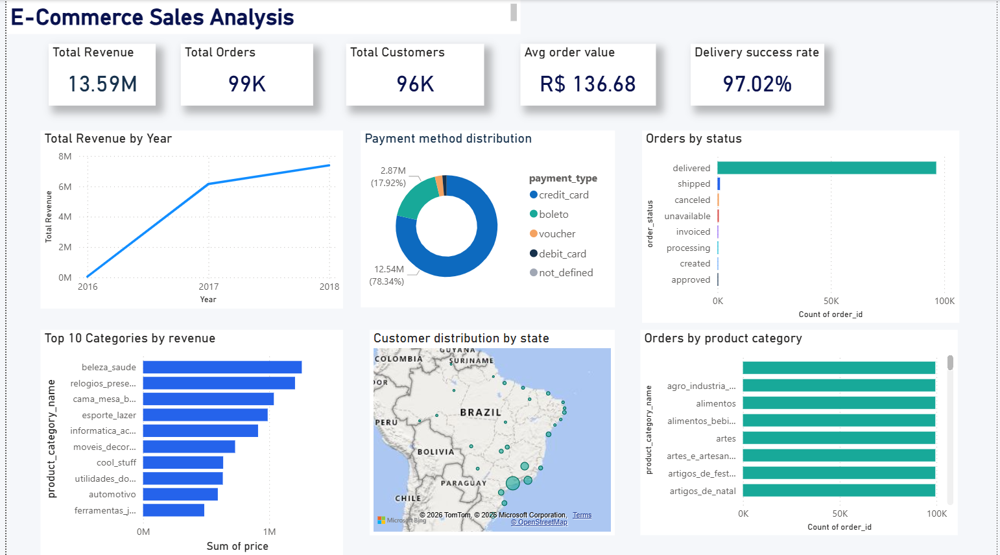

# 🛒 E-Commerce Sales Analysis

## 📌 Project Overview

This project focuses on analyzing e-commerce sales data to understand customer purchasing behavior, sales performance, product trends, and customer reviews.

The project uses Python, MySQL, Excel, and Power BI to perform data cleaning, data analysis, SQL querying, and interactive dashboard creation.

## 🎯 Project Objectives

- Analyze overall e-commerce sales performance.
- Understand customer purchasing patterns.
- Identify top-performing products and categories.
- Analyze customer reviews and satisfaction.
- Study order and payment trends.
- Present meaningful business insights through visualizations.

## 🛠️ Technologies Used

| Technology | Purpose |
|---|---|
| Python | Data cleaning and analysis |
| Pandas | Data manipulation |
| MySQL | Database management and SQL analysis |
| Excel | Data exploration |
| Power BI | Interactive dashboards |

## 📂 Project Structure

```text
E-Commerce-Sales-Analysis/
│
├── data/
│   ├── raw/
│   └── processed/
│
├── python_analysis/
│
├── sql/
│
├── src/
│
├── reports/
│
├── PowerBI/
│   ├── E-Commerce-Sales-Dashboard.pbix
│   └── Dashboard_Screenshot.png
│
└── README.md
```

## 📊 Dataset Information

The project uses the Brazilian E-Commerce Public Dataset by Olist.

The datasets contain information about:

- Customers
- Orders
- Order Items
- Products
- Payments
- Reviews
- Sellers
- Product Categories
- Geolocation

## 🔍 Project Workflow

1. **Data Collection:** Import the e-commerce datasets.
2. **Data Cleaning:** Handle missing values, duplicates, and inconsistencies using Python.
3. **Data Analysis:** Explore customer behavior, sales, products, and reviews.
4. **SQL Analysis:** Perform queries to retrieve meaningful business information.
5. **Data Visualization:** Build an interactive Power BI dashboard.
6. **Insights:** Interpret the results to support business decisions.

## 📈 Power BI Dashboard

The Power BI dashboard presents the analysis of e-commerce sales data through interactive visualizations.

**Dashboard Screenshot:**



**Power BI File:** `PowerBI/E-Commerce-Sales-Dashboard.pbix`

Download the PBIX file from this repository and open it using Power BI Desktop.

## 💡 Key Business Questions

- Which products and categories perform best?
- How do sales trends change over time?
- What are the customer purchasing patterns?
- Which payment methods are commonly used?
- How do customers rate their shopping experiences?
- What insights can help improve business performance?

## 🏁 Conclusion

This project demonstrates the use of data analytics tools to transform raw e-commerce data into meaningful information. It combines Python, SQL, Excel, and Power BI to explore business performance and support data-driven decision-making.

## 👩‍💻 Author

**Bhavya**

GitHub: [paluchanibhavya99-alt](https://github.com/paluchanibhavya99-alt)

---

⭐ If you find this project interesting, feel free to explore the repository!
